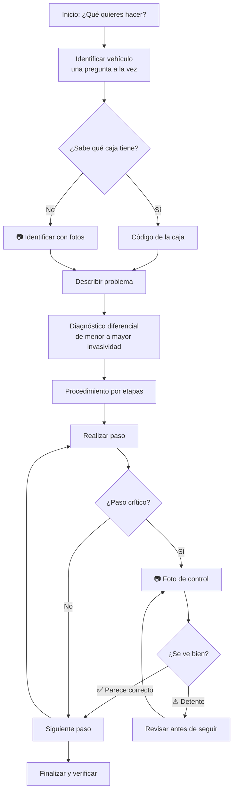

# 01 · Objetivo y alcance del prototipo

## 1. Visión

Que cualquier mecánico de habla hispana sienta que tiene **un especialista en transmisiones automáticas a su lado en el taller**: alguien que entiende cómo habla, le pide la foto correcta, le dice qué hacer ahora y lo frena antes de que cometa un error caro.

## 2. Problema

| Situación en el taller | Consecuencia |
|---|---|
| Cada modelo y año puede traer cajas distintas según motor o mercado | Se usa el procedimiento o la pieza de otra variante |
| La documentación técnica suele estar en inglés, alemán o japonés | El mecánico no la consulta o la interpreta mal |
| Los torques, tipos de ATF y capacidades se "recuerdan" o se sacan de foros | Roscas barridas, cuerpos de válvulas flojos, fallas que vuelven |
| Se desarma antes de hacer pruebas externas | Horas de trabajo innecesario |
| No hay a quién preguntar con las manos sucias y el carro en el elevador | Se avanza con dudas |

## 3. Objetivo del prototipo

Validar, con el menor costo posible, si vale la pena construir el producto completo. El prototipo debe responder:

1. **¿Lo pueden usar sin ayuda?** Un mecánico de 50–60 años, con formación tecnológica básica, entiende la app al abrirla.
2. **¿Les sirve en un trabajo real?** El flujo guiado ahorra tiempo, evita errores o da seguridad para seguir.
3. **¿Confían en él?** Que el asistente diga "no confirmado" y se detenga ante dudas genera confianza y no frustración.
4. **¿Las fotos funcionan?** El análisis de fotos ayuda de verdad a identificar cajas y piezas y a verificar pasos.

## 4. Usuarios

**Usuario principal:** mecánico de taller, especialista o generalista, con mucha experiencia práctica en vehículos, que:
- trabaja con guantes o manos sucias, poca luz y el teléfono a distancia;
- prefiere instrucciones cortas y palabras de taller;
- sabe tomar fotos con el celular;
- muchas veces no conoce el código exacto de la transmisión.

**Usuario secundario:** propietario de vehículo con experiencia mecánica que quiere orientación técnica.

## 5. Alcance — qué SÍ incluye este prototipo

| Área | Incluido |
|---|---|
| Idioma | Toda la interfaz y todas las respuestas en español |
| Inicio | 7 acciones principales en botones grandes |
| Identificación | Marca, modelo, año, motor y transmisión, una pregunta por pantalla; identificación de la caja por fotos cuando no se conoce el código |
| Diagnóstico | Tipo de falla, cuándo ocurre, detalle libre; diagnóstico diferencial ordenado con la prueba que confirma cada causa |
| Fotos | Tomar o subir fotos; solicitud guiada (qué, desde dónde, distancia, qué debe verse); análisis con nivel de confianza |
| Reparación | Procedimiento por etapas, una tarjeta por paso, torque destacado, precauciones, fotos de control en pasos críticos |
| Ayuda contextual | "¿Qué hago ahora?", "No entiendo" (explica de otra forma), "No coincide" (detiene el procedimiento) |
| Seguridad | Advertencias antes de pasos con riesgo (levantar el carro, ATF caliente, resortes, electricidad) |
| Confianza | Etiquetas 🟢 Confirmado · 🟡 Probable · 🟠 Hipótesis · 🔴 No confirmado |
| Estado | Ficha del vehículo, etapas del trabajo, piezas identificadas |
| Memoria | Trabajos guardados por usuario; "¿Dónde íbamos?" |
| Voz | Lectura en voz alta de la respuesta; dictado mediante el micrófono del teclado del teléfono |

## 6. Fuera de alcance (por ahora)

- **Búsqueda en manuales, internet, catálogos o TSB.** El asistente no confirma especificaciones por su cuenta (ver [06-limitaciones-y-roadmap.md](06-limitaciones-y-roadmap.md)).
- Micrófono integrado en la app (se usa el del teclado).
- Lectura de códigos DTC con escáner conectado al vehículo.
- Historial de fotos dentro del trabajo (solo se guarda lo que el asistente concluyó).
- Cuentas de taller, varios mecánicos sobre el mismo trabajo, órdenes de trabajo o facturación.
- Funcionamiento sin conexión a internet.
- Otros sistemas del vehículo (motor, frenos, suspensión). El foco es la transmisión.

## 7. Flujo principal

En cualquier punto el mecánico puede tocar **⚠️ NO COINCIDE**, y el asistente detiene el procedimiento y pregunta qué no coincide.

## 8. Criterios de éxito del piloto

| Indicador | Meta sugerida |
|---|---|
| Mecánicos que completan un diagnóstico sin ayuda externa | ≥ 4 de 5 |
| Tiempo hasta la primera respuesta útil | < 3 minutos desde que abren la app |
| Fotos de control que el mecánico considera bien evaluadas | ≥ 80 % |
| Casos en que el asistente inventa un dato técnico | 0 |
| Mecánicos que la volverían a usar en su próximo trabajo | ≥ 3 de 5 |

La forma de medirlos está en [07-guia-de-pruebas.md](07-guia-de-pruebas.md).
