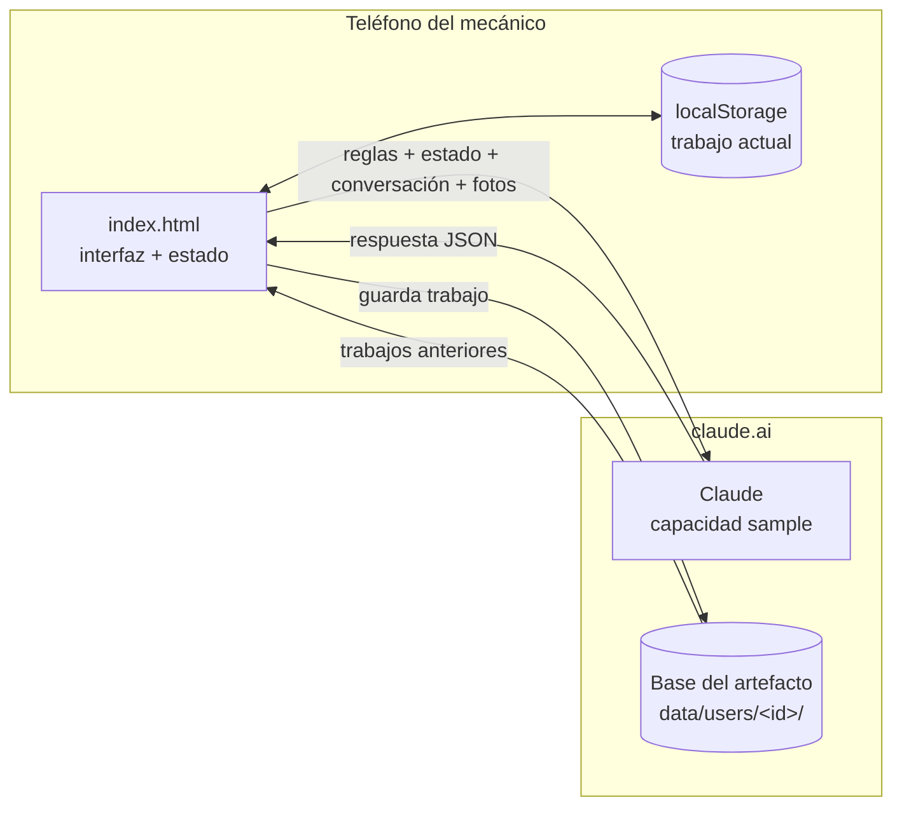
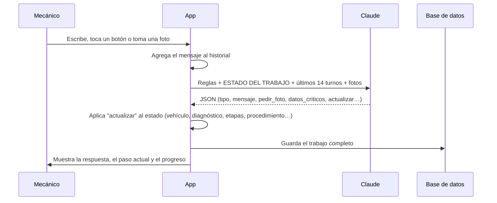

# 04 · Arquitectura técnica

## 1. Resumen

El prototipo es **una sola página HTML** (`index.html`) con CSS y JavaScript sin dependencias ni proceso de compilación. Está diseñado para publicarse como **artefacto en claude.ai**, donde la página recibe tres capacidades del entorno de Claude:

| Capacidad | Para qué se usa |
|---|---|
| `sample` (con imágenes) | Enviar la conversación, el estado del trabajo y las fotos a Claude, y recibir la respuesta en JSON |
| `db` | Guardar los trabajos de cada usuario en su espacio privado |
| `user` | Obtener el identificador del usuario para separar sus trabajos |

Fuera de claude.ai esas capacidades no existen. La app lo detecta, muestra "Asistente sin conexión" y sigue funcionando para recorrer la interfaz, guardando el trabajo solo en el navegador (`localStorage`).



## 2. Componentes de la página

| Bloque | Función |
|---|---|
| Barra superior | Marca, vehículo actual, Progreso (teléfono) e Inicio |
| Zona principal | Inicio · Asistente de preguntas · Área de trabajo |
| Columna lateral | Ficha del vehículo, progreso, piezas (en escritorio) |
| Barra inferior fija | Campo de texto, FOTO, HABLAR, ¿QUÉ HAGO AHORA?, NO ENTIENDO, NO COINCIDE |

### Vistas

- **`inicio`** — 7 acciones, "Continuar trabajo" y trabajos anteriores.
- **`wizard`** — preguntas una a la vez (vehículo, transmisión, problema, consulta). Al terminar arma un mensaje inicial para el asistente.
- **`asistente`** — tarjeta de respuesta de la IA, tarjeta del paso actual, posibles causas y conversación plegada.

## 3. Ciclo de una consulta



Cada consulta es independiente: Claude no recuerda nada entre llamadas. Por eso la app le envía siempre las reglas, el **estado resumido del trabajo** y los últimos turnos de conversación. Las respuestas no se guardan en caché (`cache: false`) para que "No entiendo" o "¿Qué hago ahora?" den una respuesta nueva.

## 4. Modelo de datos — un trabajo

Cada trabajo se guarda como un documento en `data/users/<id-del-usuario>/<id-del-trabajo>`. Ese espacio es privado: solo lo ve el usuario dueño.

```json
{
  "id": "t1a2b3c",
  "creado": 1767000000000,
  "actualizado": 1767000300000,
  "intencion": "Diagnosticar una falla",
  "vehiculo": { "marca": "Kia", "modelo": "Sportage", "anio": "2018", "motor": "2.0 gasolina", "transmision": "A6MF1" },
  "problema": { "tipo": "Da golpes", "cuando": "En caliente", "detalle": "Golpe al pasar de 2ª a 3ª" },
  "diagnostico": [ { "causa": "Nivel o estado del ATF", "confianza": "probable", "prueba": "Revisar nivel en caliente" } ],
  "etapas": [ { "nombre": "Identificación", "estado": "hecho" } ],
  "procedimiento": {
    "titulo": "Revisión de cuerpo de válvulas",
    "herramientas": [], "piezas": [],
    "pasos": [ { "titulo": "Retira el cárter", "instruccion": "", "herramienta": "", "torque": "", "torque_confianza": "no_confirmado", "precaucion": "", "foto_checkpoint": true, "que_fotografiar": "", "hecho": false, "verificado": false } ]
  },
  "pasoActual": 0,
  "piezas": [],
  "notas": [],
  "ultima": { "tipo": "pregunta", "mensaje": "…" },
  "historial": [ { "role": "user", "content": "…" }, { "role": "assistant", "content": "…" } ]
}
```

*Los valores del ejemplo son ilustrativos.*

Reglas de guardado:
- El historial se recorta a los últimos 40 turnos; a Claude se le envían los últimos 14.
- Las fotos **no** se guardan: se envían en la consulta y queda registrado solo "📷 N foto(s)" y lo que el asistente concluyó.
- Las escrituras a la base se encadenan una tras otra para no pisarse.

## 5. Fotos de control

1. El asistente marca un paso con `foto_checkpoint: true`.
2. La tarjeta del paso oculta "Siguiente" y muestra **TOMAR FOTO DE CONTROL**.
3. La foto se envía indicando que es la verificación del paso N.
4. Si el asistente responde `verificacion: "ok"`, el paso queda como hecho y verificado y aparece **SIGUIENTE PASO →**.
5. Si responde `"detener"`, la tarjeta se pone en rojo con **⚠️ DETENTE** y el paso sigue bloqueado.

## 6. Manejo de errores

| Situación | Lo que ve el mecánico |
|---|---|
| Página abierta fuera de Claude o permiso rechazado | "Asistente sin conexión / no disponible" con instrucciones |
| Demasiadas consultas seguidas | "Muchas consultas seguidas. Espera un momento…" |
| Foto que no se puede abrir | "No pude abrir esa foto. Toma otra, con buena luz." |
| Respuesta incompleta | "La respuesta llegó incompleta. Vuelve a enviar." |
| Falla de conexión | "No hubo conexión con el asistente. Intenta de nuevo." |
| Cancelar | Botón ✋ Cancelar mientras el asistente piensa |

## 7. Diseño visual

- Tipografías: **Barlow Semi Condensed** (títulos, botones) y **Barlow** (texto), desde Google Fonts, con respaldo del sistema.
- Paleta sobria azul acero con colores solo para estados: verde correcto, ámbar advertencia, rojo detener, azul información.
- Tema claro y oscuro automáticos, según el teléfono.
- Respeta "reducir movimiento" del sistema operativo.

## 8. Cómo publicar una nueva versión

1. Editar `index.html`.
2. Publicarlo como artefacto en claude.ai con las capacidades `sample` (con imágenes), `db` y `user`.
3. Para ver solo la interfaz, abrir `index.html` en un navegador o publicarlo en GitHub Pages (sin IA).
